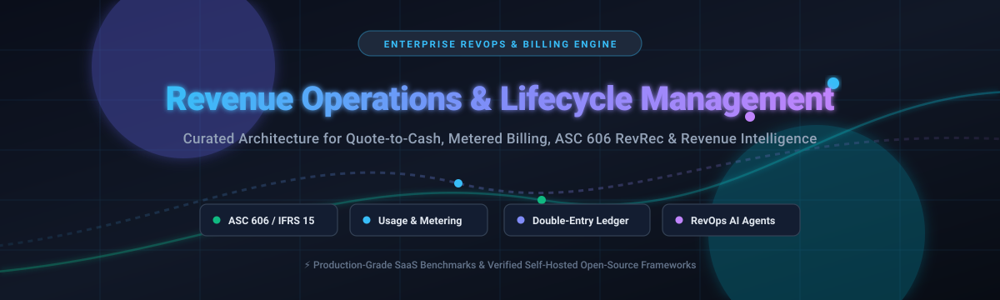
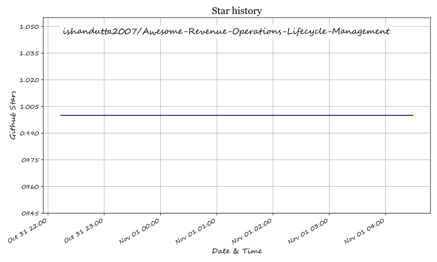

# 📈 Awesome Revenue Operations & Lifecycle Management

  
  
  

  <b>A curated catalog of awesome Revenue Operations (RevOps), quote-to-cash, subscription billing lifecycle, ASC 606 revenue recognition platforms, and self-hosted open-source revenue intelligence tools.</b>

---

Revenue Operations (RevOps) aligns sales, marketing, finance, and customer success across the end-to-end customer journey. This repository tracks notable commercial SaaS platforms and open-source software powering subscription lifecycle management, billing engines, automated revenue recognition, and revenue data platforms.

---

## 📑 Contents

- [📊 Sector Overview & Market Dynamics](#-sector-overview--market-dynamics)
- [☁️ SaaS Platforms](#️-saas-platforms)
- [💻 Open-Source Projects](#-open-source-projects)
- [🏗️ Frameworks for Custom Architectures](#️-frameworks-for-custom-architectures)
- [📈 Star History](#-star-history)
- [💖 Support](#-support)
- [🤝 How to Contribute](#-how-to-contribute)
- [⚖️ Disclaimer](#️-disclaimer)

---

## 📊 Sector Overview & Market Dynamics

The global Revenue Operations (RevOps) software and platform market is estimated between **$4.4B and $6.2B**, projected to surge past **$17B–$21.7B** at a 15–17% CAGR. The sector remains **moderately to highly fragmented** rather than winner-take-all, divided across specialized sub-domains (conversation intelligence, pipeline forecasting, usage billing, CPQ, and ASC 606/IFRS 15 revenue recognition) where enterprise giants (Salesforce, HubSpot) co-exist with focused best-of-breed suites (Clari, Gong, Chargebee, Maxio).

---

## ☁️ SaaS Platforms

Commercial cloud platforms for revenue intelligence, deal execution, automated billing, and compliance-grade revenue recognition. Sorted by enterprise scale (revenue / market valuation descending).

| Platform | Category / Primary Focus | Company Size (Valuation / Scale) | Pricing Model & Starting Tier | Free Tier Limits / Trial Terms |
| :--- | :--- | :--- | :--- | :--- |
| **[HubSpot Revenue Hub](https://www.hubspot.com/)** | Unified CRM, Quote-to-Cash, Invoicing & Forecasting | ~$13B+ Market Cap (NYSE: HUBS) | Paid tiers start at **$20/user/mo** (Starter Sales/Payments) up to **$85–$100/user/mo** (Professional) | **Free tier available**: $0/mo Smart CRM & payments tool (max 2 users); **14-day free trial** for Professional/Enterprise tiers |
| **[Gong](https://www.gong.io/)** | Conversation Intelligence & Revenue AI Workflow | ~$4.5B Valuation ($500M+ ARR) | Quote-based; base licenses start at **$100–$140/user/mo** (+ platform fee starting at ~$5,000/yr) | **No free tier**; **no self-serve free trial** (access via sales-guided pilot or custom enterprise POC) |
| **[Chargebee RevRec](https://www.chargebee.com/)** | Subscription Billing Lifecycle & ASC 606 Compliance | ~$3.5B Valuation (Peak Series H) | Add-on module; annual commitments typically starting from **~$5,000/year** (or ~$415/mo) | **No free tier for RevRec** (core Billing has a Starter plan free up to **$250,000 lifetime billing**); **no free trial** for RevRec |
| **[Clari](https://www.clari.com/)** | Predictive Forecasting, Deal Risk & Pipeline Governance | ~$2.6B Valuation (~$180M ARR) | Quote-based; core forecasting modules start at **$100–$120/user/mo** (annual contract required) | **No free tier**; **no self-serve free trial** (enterprise evaluation conducted via vendor-assisted demo sandbox) |
| **[Maxio](https://www.maxio.com/)** | B2B SaaS Financial Operations, Metrics & RevRec | ~$100M+ ARR ($50M+ funding) | Grow tier starts at **$599/month** (for up to $100K/mo billings); Scale tier is custom | **Build Sandbox plan**: Free forever developer sandbox for API/SDK testing (0 live billings); **no live free trial** |
| **[Subskribe](https://www.subskribe.com/)** | Unified CPQ, Subscription Billing & Revenue Automation | Acquired by DealHub ($18.4M funding) | Custom enterprise quote; comprehensive quote-to-revenue packages start at **~$140,000/year** | **No free tier**; **no self-serve free trial** (custom interactive product tour and demo upon qualification) |
| **[Leapfin](https://www.leapfin.com/)** | Revenue Subledger & Financial Close Automation | Acquired by Airwallex ($26.7M funding) | Custom annual subscription; baseline plans start at **$500–$1,000/month** depending on transaction volume | **No free tier**; **no self-serve free trial** (guided proof-of-concept for enterprise ERP and payment data pipelines) |
| **[Ordway](https://ordwaylabs.com/)** | Complex Subscription & Usage-Based Billing Lifecycle | $20M+ Growth Funding | Platform contracts start at **$79–$200/month** for entry tiers; full enterprise packages custom-quoted | **No free tier**; **no self-serve free trial** for the software (custom sandbox environment available during sales process) |
| **[Monetize360](https://www.monetize360.com/)** | Composable Consumption & AI Billing Infrastructure | Early-stage VC-backed ($3M–$5M ARR est.) | Custom enterprise contract based on event metering and billing workflows | **No free tier**; **no self-serve free trial** (enterprise architecture review and custom PoC only) |

---

## 💻 Open-Source Projects

Self-hosted billing engines, revenue intelligence pipelines, CPQ packages, and accounting-grade revenue recognition tools. Sorted by GitHub Stars_Count descending.

| Project | GitHub_Stars | Language / Tech Stack | Primary Focus & Capabilities |
| :--- | :--- | :--- | :--- |
| **[Lago](https://github.com/getlago/lago)** |  | Ruby / Go | **Open-source metering and usage-based billing platform**. Provides high-scale consumption tracking, subscription lifecycle management, automated invoicing, real-time credit drawdowns, and native payment processor orchestration (Stripe, Adyen, GoCardless). |
| **[Polar](https://github.com/polarsource/polar)** |  | Python / FastAPI / React | **Modern billing and merchant platform for developers**. Manages subscription checkouts, digital product licensing, usage meters, custom discounts, and developer payout infrastructure. |
| **[Kill Bill](https://github.com/killbill/killbill)** |  | Java | **Enterprise subscription billing and payments engine**. Built for mission-critical deployments with multi-tenancy, real-time catalog management, automated dunning, tax integrations, and granular double-entry transaction histories. |
| **[Zapier GTM Cheat Codes](https://github.com/zapier/gtm-cheat-codes)** |  | Markdown / Prompts / Agent Skills | **Field guide and agent workflows for Go-to-Market & RevOps teams**. Installable skills for coding agents (Claude, Codex) covering pipeline management, CRM context synchronization, campaign planning, and reviewable revenue tasks. |
| **[Inspector](https://github.com/getbeton/inspector)** |  | TypeScript / Python | **Open-source revenue intelligence platform**. Connects PostHog product analytics with CRM data to detect buying signals, surface product-qualified leads (PQLs), and trigger real-time routing to sales reps (self-hosted alternative to Pocus and Common Room). |
| **[BasaltCRM](https://github.com/BasaltHQ/crm-official)** |  | TypeScript / Next.js | **AI-native CRM and revenue pipeline tool**. Covers end-to-end GTM stages (LeadGen → Accounts → Opportunities → Quotes → Contracts → Invoices) with built-in AI Insights for deal risk detection and velocity tracking. |
| **[SwiftCPQ](https://github.com/christopher-talke/SwiftCPQ)** |  | Vue.js / JavaScript | **Vendor-agnostic proposal generation and CPQ tool**. Lightweight open-source alternative to proprietary quoting suites, focused on product catalog configuration and dynamic quoting. |
| **[eRev](https://github.com/ChipmunkRPA/eRev)** |  | Python / SQLite | **ASC 606 / IFRS 15 revenue recognition engine**. Pure-Python local system featuring contract amortizations, tamper-resistant tracking, and zero-cloud dependency with PowerBI/Tableau analytics export. |
| **[Autumn Python SDK](https://github.com/useautumn/autumn-py)** |  | Python | **Flexible billing and pricing layer**. Handles entitlement checks, credit deduction, usage limits, and Stripe plan management through concise SDK methods (`attach`, `check`, `track`). |
| **[Recurso](https://github.com/recurso-dev/recurso)** |  | Go / PostgreSQL | **Self-hosted billing engine with ASC 606 revenue recognition**. Complete with authoritative double-entry general ledger, 8 usage aggregations, smart dunning bandits, India GST support, and MCP server for agentic operations. |
| **[B2B SaaS RevOps Intelligence](https://github.com/farrux05-ai/b2b-saas-revops-intelligence)** |  | SQL / dbt / Python | **Production-grade RevOps data platform**. Ingests CRM, billing, and product analytics (PostHog, HubSpot, Stripe) into Snowflake via dlt, models MRR waterfalls and NRR in dbt, and performs Reverse ETL back to HubSpot. |
| **[RevenueOS](https://github.com/unempyd/revenueos)** |  | Python / TypeScript | **Autonomous RevOps agent orchestration framework**. Discovers revenue opportunities across mailboxes, documents, community discussions, and growth metrics to execute approved revenue tasks. |
| **[nexus-sales-operations](https://github.com/azaharizaman/nexus-sales-operations)** |  | PHP / Composer | **Order-to-Cash workflow orchestrator**. Implements progressive disclosure across three tiers: Quote-to-Order and Direct Invoicing (Tier 1), Credit Checks (Tier 2), and Revenue Recognition & Approvals (Tier 3). |

---

## 🏗️ Frameworks for Custom Architectures

When constructing custom enterprise RevOps and billing stacks:

- 💳 **Usage Metering & Invoicing**: [Lago](https://github.com/getlago/lago) and [Polar](https://github.com/polarsource/polar) deliver robust event-driven billing APIs without vendor lock-in.
- 📚 **Ledger-Grade Revenue Recognition**: [Recurso](https://github.com/recurso-dev/recurso) pairs a double-entry ledger with automated ASC 606 recognition; [eRev](https://github.com/ChipmunkRPA/eRev) handles desktop accounting workflows.
- ⚙️ **Enterprise Subscription Infrastructure**: [Kill Bill](https://github.com/killbill/killbill) offers battle-tested scale and multi-tenant payment routing.
- 🔄 **Warehouse-Centric RevOps Intelligence**: The [B2B SaaS RevOps Intelligence Engine](https://github.com/farrux05-ai/b2b-saas-revops-intelligence) and [Inspector](https://github.com/getbeton/inspector) enable Reverse ETL and signal-based sales orchestration.
- 📑 **Order-to-Cash & CPQ**: Combine [SwiftCPQ](https://github.com/christopher-talke/SwiftCPQ) for front-end configure-price-quote and [nexus-sales-operations](https://github.com/azaharizaman/nexus-sales-operations) for order processing.

---

## 📈 Star History

---

## 💖 Support

Thank you for visiting and using this resource! 🙏

If you found this curated list helpful for evaluating revenue operations architectures, please consider:
- ⭐ **Starring** this repository to help others discover it.
- 🍴 **Forking** the repo and contributing additional tools or updates.
- 📢 **Sharing** this repository with your engineering, finance, and RevOps peers.
- ☕ **Buying a coffee / sponsoring** the project via the [GitHub Sponsors Dashboard](https://github.com/sponsors/ishandutta2007). Your support helps keep this guide active and thoroughly maintained!

---

## 🤝 How to Contribute

Contributions are welcome! To propose new platforms, frameworks, or updates:

1. Fork this repository.
2. Update `README.md` following existing table standards.
3. Include verifiable links, transparent starting tiers, and clear architectural boundaries.
4. Submit a Pull Request with a clear description of your additions.

---

## ⚖️ Disclaimer

- This curated list is maintained for educational and architectural evaluation purposes.
- Revenue recognition tooling must adhere to GAAP (ASC 606) and IFRS 15 standards. Operators using self-hosted platforms assume full legal and accounting responsibility for ledger reconciliation and tax compliance.
- All product names, logos, and brands are property of their respective owners.

## Star History

<a href="https://star-history.com/#ishandutta2007/Awesome-Revenue-Operations-Lifecycle-Management&Timeline" align="center">
  <picture>
    <source media="(prefers-color-scheme: dark)" srcset="assets/ishandutta2007_Awesome-Revenue-Operations-Lifecycle-Management_growth.svg">
    
  </picture>
</a>
